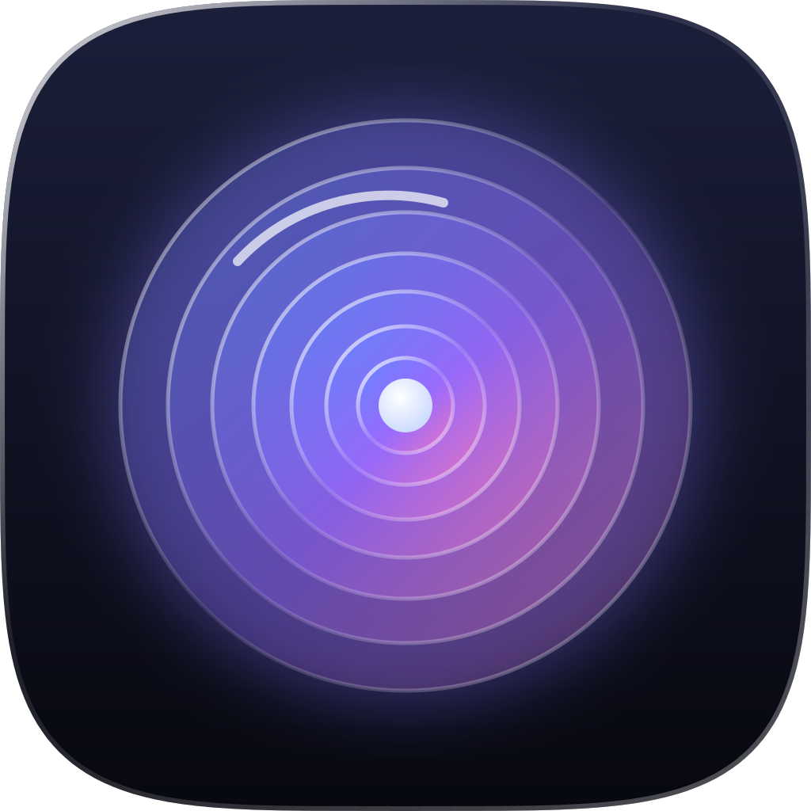
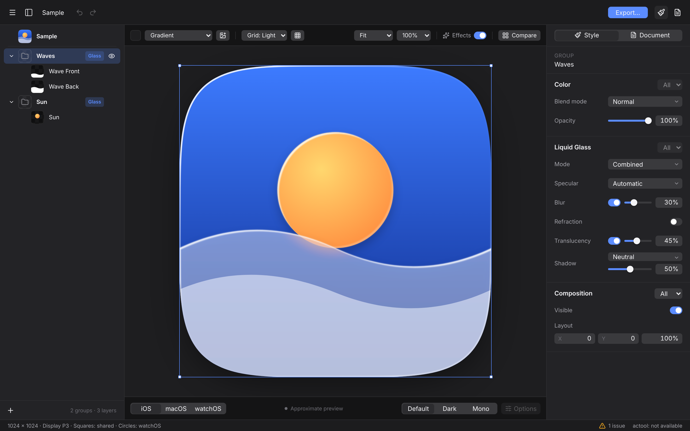
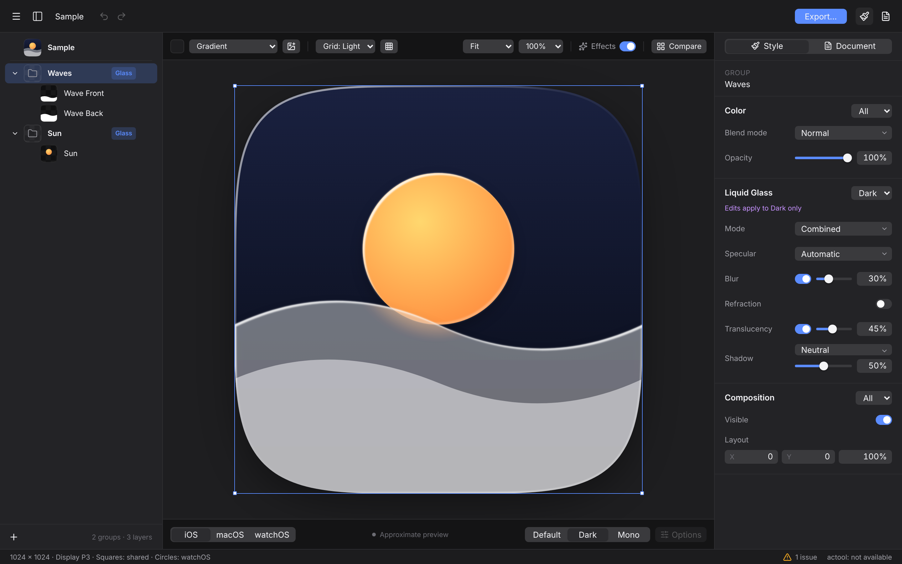
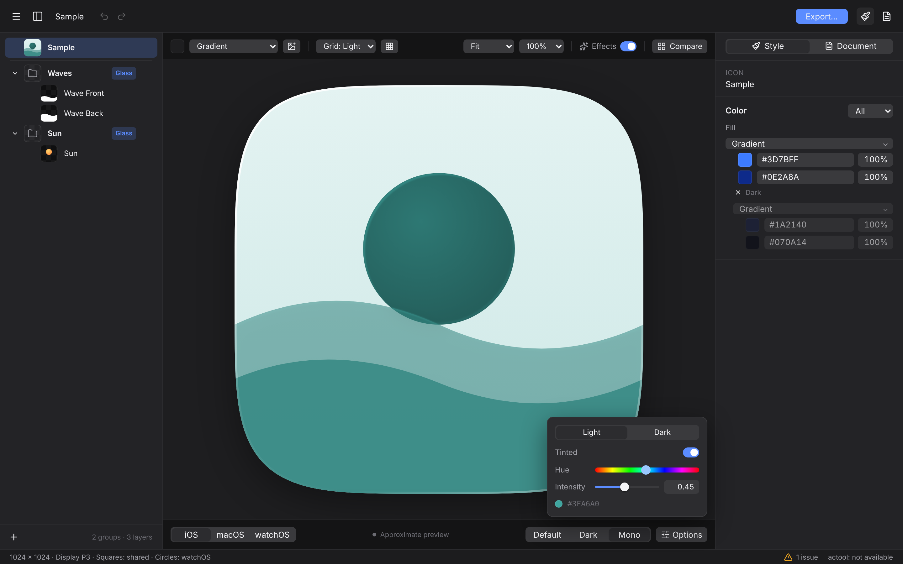
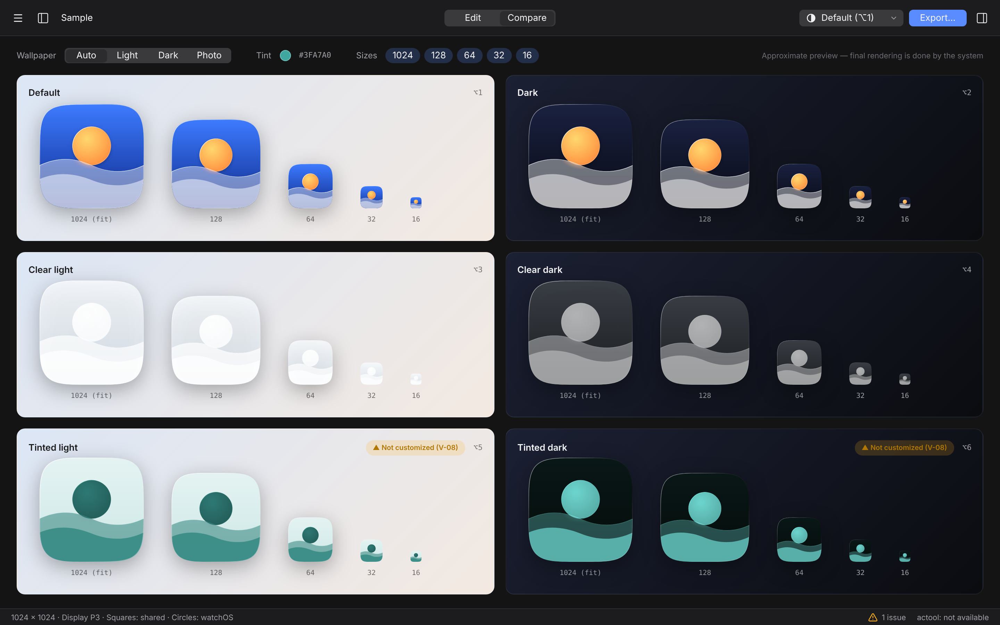
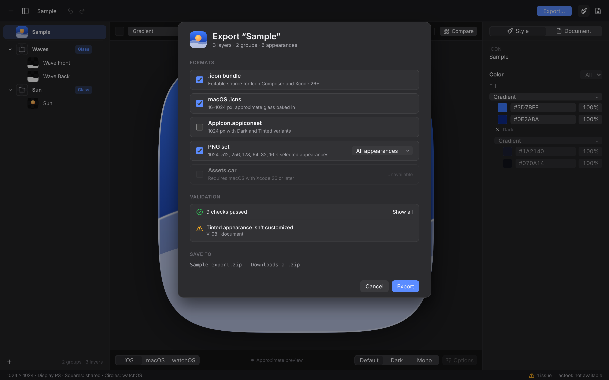
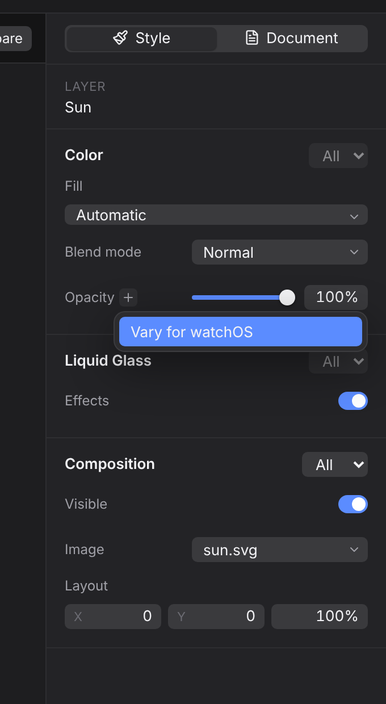

<p align="center"></p>

<p align="center">
  <picture>
    <source media="(prefers-color-scheme: dark)" srcset="brand/logo/fresnel-wordmark-white.svg">
    
  </picture>
</p>

<p align="center"><b>Open-source Liquid Glass icon composer.</b><br>
Build layered app icons for iOS, iPadOS, macOS and watchOS in the browser, on macOS, Windows or Linux, from the command line, or by asking your AI agent.</p>

<p align="center">
  <a href="https://kajisho5.github.io/fresnel/"><b>Open the web app</b></a> ·
  <a href="docs/USER_GUIDE.md">User guide</a> ·
  <a href="docs/USER_GUIDE.ja.md">日本語ガイド</a> ·
  <a href="#mcp-server">MCP server</a> ·
  <a href="#command-line">CLI</a> ·
  <a href="#faq">FAQ</a>
</p>

<p align="center">
  <a href="https://github.com/kajisho5/fresnel/actions/workflows/ci.yml"></a>
  <a href="https://github.com/kajisho5/fresnel/actions/workflows/pages.yml"></a>
  <a href="LICENSE"></a>
</p>



## Contents

- [Why fresnel](#why-fresnel)
- [Features](#features)
- [Get started](#get-started)
- [A five-minute tour](#a-five-minute-tour)
- [Keyboard shortcuts](#keyboard-shortcuts)
- [Export formats](#export-formats)
- [Icon checks](#icon-checks)
- [MCP server](#mcp-server)
- [Command line](#command-line)
- [Requirements](#requirements)
- [Privacy](#privacy)
- [FAQ](#faq)
- [Troubleshooting](#troubleshooting)
- [Roadmap](#roadmap)
- [Contributing and support](#contributing-and-support)
- [Credits, disclaimer and license](#credits)

## Why fresnel

Apple's Icon Composer makes layered Liquid Glass icons, but it only runs on a Mac, and the `.icon` format it writes has no public spec. fresnel is a free, open-source alternative that:

- **runs anywhere**: in the browser with nothing to install, as a small desktop app for macOS, Windows and Linux, or headless from the CLI.
- **reads and writes real `.icon` bundles**: round trips are byte-for-byte on files written by Icon Composer, and fresnel keeps keys it doesn't know.
- **works the way Icon Composer does**: the same sidebar, canvas and Style / Document inspector, the same Default / Dark / Mono preview, and the same "Vary for…" variants.
- **lets AI agents design icons**: the built-in MCP server lets Claude and other agents create, edit, view and export icons.

## Features

| | |
|---|---|
| **Layers and groups** | Drop SVG, PNG or JPEG files to add them as layers. Drop a folder to add it as a group. Drag to reorder and double-click to rename. Duplicate, group, hide or delete from the context menu. New layers get Liquid Glass automatically, as in Icon Composer. Apple recommends at most 4 groups, and fresnel warns past that. |
| **Liquid Glass** | Per group: mode (Individual / Combined), specular highlights (Off / Automatic / Inside / Outside), blur, translucency, shadow (Neutral / Chromatic), and refraction set on a 2D strength × depth pad. Per layer: glass, fill, blend mode and opacity. |
| **Appearances** | Default, Dark and Mono. Mono can be clear or tinted, light or dark, with a tint color you choose. Compare shows all six system appearances side by side. |
| **Variants** | Override any value for Dark, Mono, iOS, macOS or watchOS. Use "Vary for…" on a single setting, or a section's "Applies to" popup for a whole section. Overrides are listed under the base value, and you remove each with one click. |
| **Canvas** | Drag layers and they snap to the center. Nudge with the arrow keys. Type math into number fields (`*2`, `35*3`). Preview on wallpapers or your own image, with grids, every system size from 16 to 1024 px, zoom, and an Effects switch. |
| **Exports** | `.icon`, `.icns`, `AppIcon.appiconset` (App Store-ready, with Dark and Tinted) and PNG sets. On a Mac with Xcode 26, also `Assets.car`. |
| **Checks** | Ten checks based on Apple's HIG run as you work. See [Icon checks](#icon-checks). |
| **Safety net** | 300 undo steps. Autosave keeps a copy on your device and brings your work back after a crash or reload. |
| **Comfort** | Dark and light themes, English and Japanese, full keyboard control, screen-reader labels. |
| **Automation** | An MCP server for AI agents and a CLI for builds and CI. |

<table>
<tr>
<td></td>
<td></td>
</tr>
<tr>
<td align="center">Edit only the Dark appearance</td>
<td align="center">Mono: clear or tinted, light or dark</td>
</tr>
<tr>
<td></td>
<td></td>
</tr>
<tr>
<td align="center">Compare every appearance and size</td>
<td align="center">Export for Xcode, the App Store and the web</td>
</tr>
</table>

## Get started

| | How | Notes |
|---|---|---|
| **Web** | Open **https://kajisho5.github.io/fresnel/** | Runs entirely in your browser. In Chrome, Edge and other Chromium browsers you can open an `.icon` folder and save back into it. In Safari and Firefox, open and save `.icon.zip` files instead. |
| **Desktop** | Downloads will be on [Releases](https://github.com/kajisho5/fresnel/releases) | There's no release yet. Until then, build it yourself: `pnpm install && pnpm --filter @fresnel/desktop build` (needs Rust). |
| **CLI and MCP** | From source (see [Command line](#command-line)) | npm packages (`fresnel-icon`, `fresnel-mcp`) are planned. |

## A five-minute tour

The [user guide](docs/USER_GUIDE.md) explains every control. Here's the short version.

1. **Start.** Open the web app and a sample icon loads. For an empty icon, choose **Menu → New**. To open an existing one, drop an `.icon` folder or `.icon.zip` on the window.
2. **Add artwork.** Drop your layer files on the window, or click **＋ → New Image…** in the sidebar. Make each layer a 1024×1024 square with a transparent background and no rounded corners, because the system masks the icon for you. SVG works best.
3. **Arrange.** The sidebar lists the frontmost item first. Drag to reorder, or press ⌘] and ⌘[. Put layers that should share glass settings in one group (⌘G).
4. **Style.** Select a group to set **Liquid Glass**: translucency, blur, specular and shadow. Select a layer to set **Color** (fill, blend mode, opacity) and **Composition** (position and scale).
5. **Check every appearance.** Switch between **Default / Dark / Mono** at the bottom right (⌥1 – ⌥3) and the platform (**iOS, macOS** or **watchOS**) at the bottom left. To change a value for the current appearance only, set the section's popup from **All** to **Dark**, or click **＋ → Vary for…** next to a setting.
6. **Compare.** Press ⌘2 to see all six appearances at every size. The small sizes show what still reads at 16–64 px.
7. **Export.** Press ⇧⌘E. Choose `.icon` for Xcode 26, `AppIcon.appiconset` for older Xcode projects, `.icns` for macOS, or PNG sets.



**How variants work.** A value set under **All** applies everywhere. A variant row under it, such as **Dark** or **watchOS**, overrides that one case. The highlighted variant is the one currently on the canvas. Click **×** to remove a variant.

<br clear="right">

## Keyboard shortcuts

On Windows and Linux, use Ctrl instead of ⌘.

| Action | Shortcut | | Action | Shortcut |
|---|---|---|---|---|
| New icon | ⌘N | | Undo / Redo | ⌘Z / ⇧⌘Z |
| Open | ⌘O | | Duplicate | ⌘D |
| Save / Save As | ⌘S / ⇧⌘S | | Delete | ⌫ |
| Export… | ⇧⌘E | | Group / Ungroup | ⌘G / ⇧⌘G |
| Add image layers | ⇧⌘I | | Bring forward / Send backward | ⌘] / ⌘[ |
| Edit / Compare | ⌘1 / ⌘2 | | Show / Hide | ⇧⌘H |
| Default / Dark / Mono | ⌥1 / ⌥2 / ⌥3 | | Copy / Paste style | ⌥⌘C / ⌥⌘V |
| Zoom in / out / reset | ⌘＋ / ⌘− / ⌘0 | | Move selection | Arrow keys (⇧ = 10 pt) |
| Deselect | Esc | | Constrain a drag | Hold ⇧ |

In number fields, ↑ and ↓ change the value by one step (⇧ ×10, ⌥ ×0.1). You can also type arithmetic such as `*2`, `+10` or `35*3`. Double-click a slider to reset it.

## Export formats

| Format | Use it for | Details |
|---|---|---|
| `.icon` | Xcode 26 and later | The layered source file. Add it to your target and set it as the app icon. |
| `AppIcon.appiconset` | Asset catalogs (any Xcode) | 1024 px iOS icon, full-bleed and opaque with no alpha (as the App Store requires); a Dark variant with a transparent background and a grayscale Tinted variant, as Apple asks; the classic macOS sizes in Apple's macOS template (inset body with a shadow); and a watchOS slot when the icon targets watchOS. |
| `.icns` | macOS apps, installers, Finder | 16–1024 px with @2x, in the classic macOS template, using your macOS variants. |
| PNG set | Websites, stores, docs | Every appearance at 1024, 512, 256, 128, 64, 32 and 16 px, masked. |
| `Assets.car` | Compiled asset catalogs | Desktop app on macOS with Xcode 26 or later only (uses Apple's `actool`). |

On the web, an export downloads as one zip. The desktop app asks where to save it.

## Icon checks

fresnel checks your icon as you edit. Problems appear in the status bar and in the export sheet.

| ID | Level | Check |
|---|---|---|
| V-01 | Error | An `icon.json` value is invalid |
| V-02 | Error | A referenced image is missing from `Assets/` |
| V-03 | Warning | A layer isn't square, or is smaller than 1024 px |
| V-04 | Warning | A layer looks pre-masked (rounded corners baked in) |
| V-05 | Warning | The background isn't opaque |
| V-06 | Info | Very thin strokes may disappear at small sizes |
| V-07 | Info | An SVG contains text or custom effects |
| V-08 | Warning | Dark or Tinted isn't customized (the system will generate it) |
| V-09 | Warning | More than 4 visible groups (Apple recommends at most 4; some versions of Xcode's `actool` reject more) |
| V-10 | Error | Unsupported image format |

The rules come from Apple's [Human Interface Guidelines for app icons](https://developer.apple.com/design/human-interface-guidelines/app-icons). [docs/HIG.md](docs/HIG.md) (Japanese) explains each one.

## MCP server

fresnel includes a [Model Context Protocol](https://modelcontextprotocol.io) server, so Claude and other agents can design icons. They can create a bundle, draw layers as SVG, tune the glass, **look at the rendered result** and export it. The server uses stdio, and it can only read and write inside the folders you pass with `--root`.

**Set it up.** Until the npm package is published, build it from source:

```bash
git clone https://github.com/kajisho5/fresnel && cd fresnel
pnpm install && pnpm build
```

Claude Code:

```bash
claude mcp add fresnel -- node /path/to/fresnel/packages/mcp/dist/server.js --root ~/Icons
```

Claude Desktop, Cursor and other clients use an `mcpServers` entry in the client's config file:

```json
{
  "mcpServers": {
    "fresnel": {
      "command": "node",
      "args": ["/path/to/fresnel/packages/mcp/dist/server.js", "--root", "/Users/you/Icons"]
    }
  }
}
```

Then ask, for example: *"Design a Liquid Glass icon for a habit-tracking app called Streaks in ~/Icons, show me all appearances, and export an appiconset."*

| Tool | What it does |
|---|---|
| `icon_create` | Creates a new `.icon` with a background (`"#336699"`, `"gradient:#top,#bottom"`, `"system-dark"`, …) and an optional dark background |
| `icon_inspect` | Lists groups, layers, attributes and every variant |
| `icon_add_group` / `icon_add_layer` | Adds a group, or a layer from inline SVG, a file or PNG data |
| `icon_set` | Sets attributes for all appearances, or a variant with `appearance` (`dark`, `tinted`) and/or `platform` (`iOS`, `macOS`, `watchOS`) |
| `icon_move` / `icon_remove` | Reorders or deletes groups and layers |
| `icon_validate` | Runs the [icon checks](#icon-checks) |
| `icon_render` / `icon_render_sheet` | Returns a PNG of one appearance or of all six, as an image the model can see |
| `icon_export` | Writes `.icon`, `.icns`, `AppIcon.appiconset` and PNG sets |

The server also provides two resources, `fresnel://guide/icon-design` (Apple's icon rules, condensed) and `fresnel://schema/icon-json` (attribute reference), and one prompt, `design_app_icon`. If you have the icon open in the desktop app while the agent edits it, the app reloads it.

## Command line

```bash
node packages/cli/dist/cli.js --help        # after pnpm build ("fresnel" once it's on npm)
```

| Command | What it does |
|---|---|
| `fresnel build spec.json -o MyApp.icon` | Builds an `.icon` from a JSON spec ([example](fixtures/sample.spec.json)) |
| `fresnel inspect MyApp.icon` | Prints groups, layers and attributes as JSON |
| `fresnel validate MyApp.icon [--json] [--strict]` | Runs the checks. Exits with 1 on errors, or also on warnings with `--strict`, so you can use it in CI |
| `fresnel render MyApp.icon [-a dark] [-s 512] [--mask circle] [--sheet] [-o out.png]` | Renders a preview PNG, or a sheet of all appearances |
| `fresnel export MyApp.icon -o dist [--formats icon,icns,appiconset,png] [--sizes …] [--appearances …] [--tint #RRGGBB]` | Exports |
| `fresnel mcp --root .` | Starts the MCP server |

Appearances: `default`, `dark`, `clear-light`, `clear-dark`, `tinted-light`, `tinted-dark`.

## Requirements

| | |
|---|---|
| Web | Current Chrome, Edge, Safari or Firefox. Opening and saving `.icon` folders needs a Chromium browser (File System Access API). Other browsers use `.icon.zip`. |
| Desktop | macOS 13 or later, Windows 10 or later (WebView2), or Linux with WebKitGTK 4.1 |
| CLI and MCP | Node.js 20 or later |
| `Assets.car` export | macOS with Xcode 26 or later |

## Privacy

fresnel has no accounts, no analytics and no server. The web app is a set of static files on GitHub Pages: your icons are processed in your browser and are never uploaded. Autosave keeps a recovery copy in your browser's storage (IndexedDB), on your device only. The copy is deleted once there are no unsaved changes (for example after you save) or when you choose **Discard** in the recovery dialog. The MCP server and CLI work only with local files.

## FAQ

**Is this the same as Apple's Icon Composer?**
No. fresnel is an independent open-source tool that reads and writes the same `.icon` format and follows the same workflow. Apple's renderer is private, so fresnel's preview is a close approximation, and the system does the final rendering on the device.

**Will Xcode accept icons made with fresnel?**
fresnel writes standard `.icon` bundles. Keep to 4 groups or fewer, and check the result in Xcode or with `actool` before you ship. If an Xcode update changes the format, please [open an issue](https://github.com/kajisho5/fresnel/issues).

**Can I open icons made in Icon Composer?**
Yes. Open the `.icon` folder (in a Chromium browser or the desktop app) or a zip of it. Saving keeps everything, including settings fresnel doesn't edit.

**Where is my work saved on the web?**
In the file you save with ⌘S. Until you save, autosave keeps a recovery copy in this browser on this device.

**Do I need a Mac?**
Only to compile `Assets.car`. Everything else works on Windows, on Linux and in the browser.

**Can I use fresnel commercially?**
Yes. fresnel is MIT-licensed, and the icons you make are yours.

## Troubleshooting

| Problem | Fix |
|---|---|
| Can't open an `.icon` in Safari or Firefox | These browsers can't open folders. Zip the `.icon` folder and open the zip, or use Chrome, Edge or the desktop app. |
| A layer has jagged or doubled corners | The artwork has rounded corners baked in (check V-04). Export it as a full square and let the system mask it. |
| Layers look smaller than expected | Layers are placed at their natural size on the 1024 pt canvas. Make the artboard 1024×1024, or scale the layer in **Composition**. |
| V-09 "More than 4 groups" | Combine layers that share glass settings into one group. |
| Dark looks muddy | Give Dark its own background (**Color → Applies to → Dark**) and lighten the foreground colors slightly. |
| An `.icns` or PNG export is blank in Safari | Export again, or use Chrome or the desktop app, and [report it](https://github.com/kajisho5/fresnel/issues) with your browser version. |
| The desktop app won't open on macOS | The app isn't signed yet. Try to open it once, then go to System Settings → Privacy & Security and click **Open Anyway**. |
| A recovery dialog appeared | fresnel found unsaved work from last time. **Restore** brings it back. **Discard** deletes the copy. |

More in the [user guide](docs/USER_GUIDE.md#troubleshooting).

## Roadmap

- npm packages for `fresnel-icon` and `fresnel-mcp`, and signed desktop releases
- A WebGL refraction preview
- Recent files
- visionOS and tvOS icons

The [changelog](CHANGELOG.md) lists what's done, and [docs/DESIGN.md](docs/DESIGN.md) (Japanese) has the full spec.

## Contributing and support

- **Questions, ideas and bugs:** [Issues](https://github.com/kajisho5/fresnel/issues/new/choose). For a bug, include your browser or OS and, if you can, the `.icon` file.
- **Security:** see [SECURITY.md](SECURITY.md).
- **Code:** see [CONTRIBUTING.md](CONTRIBUTING.md).

```bash
pnpm install
pnpm dev                                # web app at http://localhost:5173
pnpm test                               # unit, MCP and CLI tests
pnpm test:e2e                           # Playwright UI tests
pnpm --filter @fresnel/desktop dev      # desktop app (needs Rust)
```

| Package | |
|---|---|
| `packages/core` | `.icon` model, lossless `icon.json` parser and serializer, editing operations, checks, `.icns` / `appiconset` / zip export |
| `packages/render` | SVG compositor for the Liquid Glass preview, shared by the browser and the CLI (resvg) |
| `packages/ui` | React UI (Zustand, Tailwind CSS v4) |
| `packages/mcp` · `packages/cli` | `fresnel-mcp` · `fresnel-icon` |
| `apps/web` · `apps/desktop` | Vite web app · Tauri v2 desktop app |

<a id="credits"></a>
## Credits, disclaimer and license

**How the format is handled.** Apple doesn't publish the `icon.json` schema. fresnel's model is based on community reverse-engineering, including [glassmith](https://github.com/digitalby/glassmith), [rozd/icon-kit](https://github.com/rozd/icon-kit), [icon-composer-template](https://github.com/peterpoliwoda/icon-composer-template) and [decant](https://github.com/kylebshr/decant), and on files written by Icon Composer itself. Every attribute keeps its original form, and unknown keys pass through untouched. The format may change with any Xcode update.

**Brand.** The logo, favicons and social images are in [`brand/`](brand/README.md). The wordmark uses [Inter](https://rsms.me/inter/) (SIL Open Font License).

**Disclaimer.** fresnel is not affiliated with or endorsed by Apple Inc. "Icon Composer", "Liquid Glass", "Xcode", "macOS", "iOS", "iPadOS" and "watchOS" are trademarks of Apple Inc. The sample icon is fictional.

**License.** [MIT](LICENSE) © kajisho5
