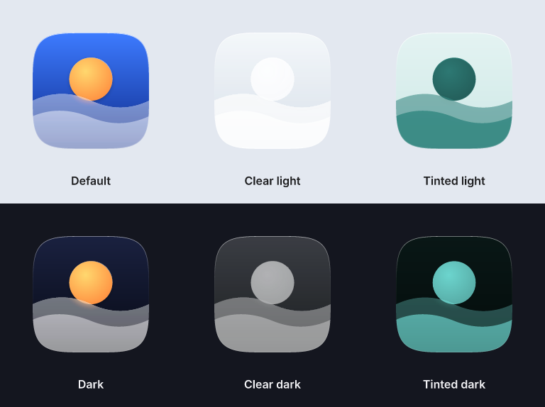

<p align="center"></p>

<p align="center">
  <picture>
    <source media="(prefers-color-scheme: dark)" srcset="brand/logo/fresnel-wordmark-white.svg">
    
  </picture>
</p>
<p align="center"><b>Open-source Liquid Glass icon composer.</b><br>
Build layered app icons for iOS, iPadOS, macOS and watchOS — on macOS, Windows, Linux, in the browser, from the command line, or by asking your AI agent.</p>

<p align="center">
  <a href="https://kajisho5.github.io/fresnel/">Web app</a> ·
  <a href="#mcp-server">MCP server</a> ·
  <a href="#cli">CLI</a> ·
  <a href="docs/DESIGN.md">Design spec</a> ·
  <a href="docs/HIG.md">HIG</a>
</p>


## Why

Apple's Icon Composer only runs on macOS, and the `.icon` format it writes has no public spec. A few open-source projects already handle parts of the format, such as CLIs and schema notes, but none of them is a **GUI editor with a live preview that runs anywhere**. fresnel fills that gap, and adds an MCP server so agents like Claude can design icons too.

- **Reads and writes real `.icon` bundles.** Round trips are byte-for-byte on files produced by Icon Composer, and unknown keys are kept.
- **Live preview of all six appearances**: Default, Dark, Clear light, Clear dark, Tinted light and Tinted dark, with a draggable light source and squircle or circle masks.
- **Feels like Icon Composer.** Default / Dark / Mono, "Vary for…" per appearance or platform, the Color, Liquid Glass and Composition sections, and the same shortcuts.
- **Autosave.** Your work is kept in the browser and offered back after a reload or crash.
- **Exports** `.icon`, `.icns`, `AppIcon.appiconset` (with Dark and Tinted variants) and PNG sets. On macOS with Xcode 26 or later it also compiles `Assets.car` through Apple's `actool`.
- **Checks your icon** against Apple's HIG: square unmasked layers, no baked corners, an opaque background, outlined text, thin strokes, missing variants, and more.



> **The preview is an approximation.** Apple's renderer is private. fresnel shows a close, consistent picture for design decisions, and the system does the final rendering on the device.

## Get it

| | |
|---|---|
| **Web** | https://kajisho5.github.io/fresnel/ — runs locally in your browser, nothing is uploaded. In Chromium-based browsers you can open an `.icon` folder and save back in place; other browsers use `.icon.zip`. |
| **Desktop** | macOS, Windows and Linux builds are on [Releases](https://github.com/kajisho5/fresnel/releases) (Tauri, a few MB). |
| **CLI** | `npx fresnel-icon --help` |
| **MCP** | `npx fresnel-mcp --root ~/Icons` |

## MCP server

Let your agent create, edit, preview and export icons. The server speaks stdio and can only read and write inside the folders you pass with `--root`.

```json
{
  "mcpServers": {
    "fresnel": { "command": "npx", "args": ["-y", "fresnel-mcp", "--root", "/path/to/icons"] }
  }
}
```

Claude Code: `claude mcp add fresnel -- npx -y fresnel-mcp --root /path/to/icons`

| Tool | What it does |
|---|---|
| `icon_create` | New `.icon` bundle with a background (`"#336699"`, `"gradient:#top,#bottom"`, `"system-dark"`, …) and an optional dark background |
| `icon_inspect` | Groups, layers, attributes and dark / tinted overrides |
| `icon_add_group` / `icon_add_layer` | Add a group, or add a layer from inline SVG, a file or PNG data |
| `icon_set` | Set attributes for all appearances, or override them for `dark` / `tinted` |
| `icon_move` / `icon_remove` | Reorder or delete groups and layers |
| `icon_validate` | Schema and HIG checks |
| `icon_render` / `icon_render_sheet` | Return a PNG preview (one appearance, or all six) as an image the model can see |
| `icon_export` | Write `.icon`, `.icns`, `AppIcon.appiconset` and PNG sets |

The server also offers two resources, `fresnel://guide/icon-design` (Apple's icon rules, condensed) and `fresnel://schema/icon-json` (attribute reference), and one prompt, `design_app_icon`. The desktop app reloads a bundle when the agent changes it on disk.

## CLI

```bash
npx fresnel-icon build fixtures/sample.spec.json -o MyApp.icon   # JSON spec → .icon
npx fresnel-icon validate MyApp.icon --strict                     # exit 1 on errors (and warnings with --strict)
npx fresnel-icon render MyApp.icon --sheet -o appearances.png      # preview all appearances
npx fresnel-icon export MyApp.icon -o dist --formats icon,icns,appiconset,png
npx fresnel-icon mcp --root .                                      # same MCP server
```

The [spec format](fixtures/sample.spec.json) lists groups front to back, with per-group and per-layer `props`, and `dark` / `tinted` overrides.

## Develop

```bash
pnpm install
pnpm dev                                # web app at http://localhost:5173
pnpm test                               # unit + MCP/CLI end-to-end tests (vitest)
pnpm test:e2e                           # Playwright UI tests
pnpm --filter @fresnel/desktop dev      # desktop app (needs Rust; Linux also needs webkit2gtk)
```

| Package | |
|---|---|
| `packages/core` | `.icon` model, lossless `icon.json` parser and serializer, editing operations, validation, `.icns` / `appiconset` / zip export |
| `packages/render` | SVG compositor for the approximate Liquid Glass preview. The browser and resvg share it, so every surface shows the same picture. |
| `packages/ui` | React UI (Zustand, Tailwind CSS v4) |
| `packages/mcp` | `fresnel-mcp` |
| `packages/cli` | `fresnel-icon` |
| `apps/web`, `apps/desktop` | Vite web app and Tauri v2 desktop app |

Docs: [design spec](docs/DESIGN.md) (Japanese) · [fresnel HIG](docs/HIG.md), the UI guidelines for the app plus the icon guide behind its checks (Japanese) · [design comps](design/)

## How the `.icon` format is handled

Apple doesn't publish the `icon.json` schema. fresnel's model is based on community reverse-engineering — [glassmith](https://github.com/digitalby/glassmith), [rozd/icon-kit](https://github.com/rozd/icon-kit), [icon-composer-template](https://github.com/peterpoliwoda/icon-composer-template) and [decant](https://github.com/kylebshr/decant) — and on files written by Icon Composer itself. Every attribute keeps its original form, plain or `*-specializations`, and unknown keys pass through untouched. The format may change whenever Xcode updates.

## Brand

The logo, favicons and social images are in [`brand/`](brand/README.md), and `pnpm brand` regenerates them. To set the repository's social preview, upload `brand/social/github-social-preview.png` in Settings → General → Social preview.

## Disclaimer

fresnel is not affiliated with Apple Inc. "Icon Composer", "Liquid Glass", "Xcode", "macOS", "iOS" and related names are trademarks of Apple Inc. The sample icon in `fixtures/` is fictional.

## License

MIT
