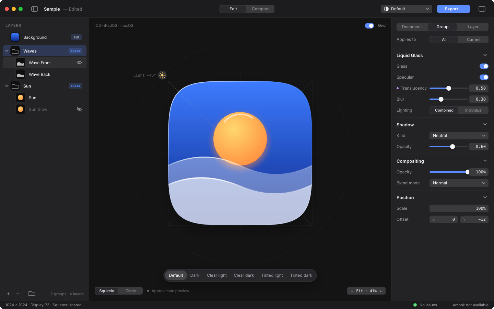
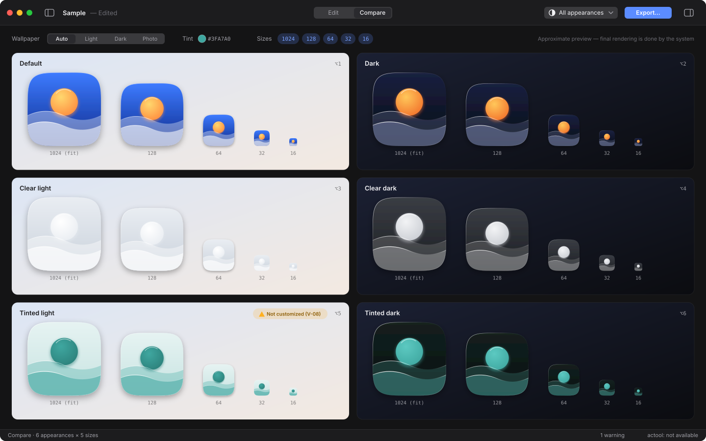
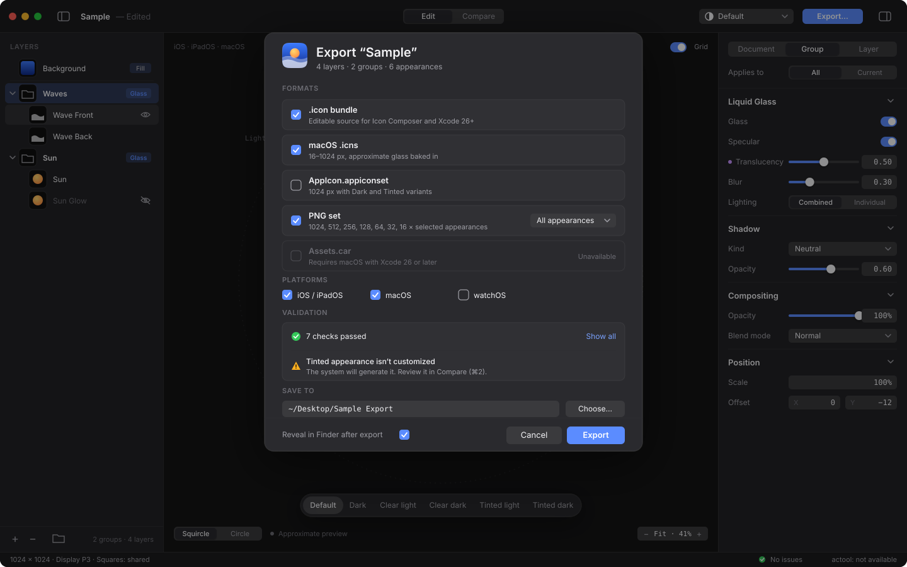

<h1 align="center">fresnel</h1>

<b>Open-source Liquid Glass icon composer.</b> 
Build layered app icons for iOS, iPadOS, macOS and watchOS — on macOS, Windows, Linux or in the browser.

> **Status: design phase.** Nothing is implemented yet. The spec and design comps are up for review.

## Why

Apple's Icon Composer is a great tool, but it only runs on macOS, and the `.icon` format it writes has no public spec. Some open-source projects already handle parts of the format — for example CLIs and schema notes — but none of them gives you a **GUI editor with a live preview that runs anywhere**. fresnel aims to fill that gap.

## Planned features (v0.1)

- Open and save `.icon` bundles (`icon.json` + `Assets/`), keeping unknown keys intact on round trip
- Layer and group editing: drag in SVG or PNG, reorder, group, hide
- Liquid Glass group settings (specular, translucency, blur, shadow, lighting) and per-layer fill, opacity, blend mode and position
- Per-appearance overrides for Default, Dark and Tinted, plus previews of all six system appearances
- Live **approximate** WebGL2 preview with a draggable light angle and squircle or circle masks
- Compare view: all six appearances × 1024 / 128 / 64 / 32 / 16
- Export to `.icon`, `.icns`, `AppIcon.appiconset` and PNG sets — and `Assets.car` via `actool` when you're on macOS with Xcode 26+
- Lint rules based on Apple's HIG (unmasked square layers, no baked corners, outlined text, and more)
- CLI: `fresnel build | validate | render`

| Compare | Export |
|---|---|
|  |  |

## Docs

- [Design spec](docs/DESIGN.md) — requirements, architecture, data model, renderer, export, roadmap (Japanese)
- [fresnel HIG](docs/HIG.md) — UI guidelines for the app itself, plus the icon-making guide behind its hints (Japanese)
- [Design tokens](design/00-tokens.svg)

## Stack (planned)

React 19 · TypeScript · Tailwind CSS v4 · Zustand · Zod · WebGL2 · Tauri v2 (desktop) · Vite (web)

## Disclaimer

fresnel is not affiliated with Apple Inc. "Icon Composer", "Liquid Glass", "Xcode", "macOS", "iOS" and related names are trademarks of Apple Inc. The `.icon` format support is based on community reverse-engineering — see [glassmith](https://github.com/digitalby/glassmith) and [rozd/icon-kit](https://github.com/rozd/icon-kit) — and may break whenever Apple changes the format. The previews approximate Apple's rendering; the system does the final rendering on the device.

## License

MIT
